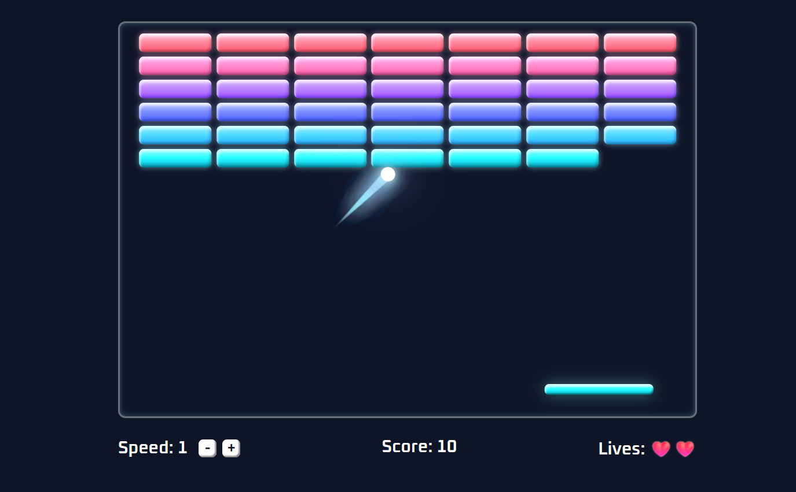

# 🧱 Breakout Game

A classic brick-breaker game built with **React + TypeScript**: a smooth `requestAnimationFrame` game loop, canvas particle effects, a fully responsive board and an installable, offline-ready PWA.

🎮 **[Play the live demo](https://alena0490.github.io/BrickBreaker/)**



---

## ✨ Features

- 🏓 **Paddle control:** mouse, touch or arrow keys
- ⚡ **Adjustable speed:** a higher speed gives a higher score per brick
- ❤️ **Lives system:** 3 lives, the ball resets to the paddle after each miss
- 🎯 **Angle-based bounces:** where the ball hits the paddle sets its rebound angle
- 🌠 **Glowing ball trail** and 💥 **brick debris** rendered on a `<canvas>` overlay
- 🔊 **Sound effects** with a mute toggle and per-sound volume
- ⏸️ **Pause / resume** via button, tap or `Space`, plus **auto-pause** when you leave the app or rotate the phone to portrait
- 🔄 **Instant restart** without reloading the page
- 🏆 **High score** saved in the browser; speed and sound settings are remembered too
- 📐 **Responsive layout:** the board, bricks, paddle, ball and effects scale to any screen, including phones in landscape
- 📱 **Installable PWA** that works offline
- ♿ **Accessible:** screen reader announcements, keyboard navigation with visible focus, reduced-motion support

## 🕹️ Controls

| Action | Mouse / keyboard | Touch |
| --- | --- | --- |
| Start | Click or `Space` | Tap the board |
| Move paddle | Mouse or `←` / `→` | Drag on the board |
| Pause / resume | `Space` or ⏸ button | ⏸ button, tap to resume |
| Speed | `-` / `+` buttons | `-` / `+` buttons |
| Sound on / off | 🔊 button | 🔊 button |
| Restart | **Play Again** after win / game over | **Play Again** |

## 🛠️ Tech Stack

- [React](https://react.dev/) + [TypeScript](https://www.typescriptlang.org/)
- [Vite](https://vitejs.dev/)
- [vite-plugin-pwa](https://vite-pwa-org.netlify.app/) (service worker, offline cache)
- [Fontsource](https://fontsource.org/) (self-hosted Oxanium font)
- [react-icons](https://react-icons.github.io/react-icons/)
- [Vitest](https://vitest.dev/) (unit tests)
- Canvas 2D API, Web Audio (`HTMLAudioElement`), `localStorage`

## 🚀 Getting Started

```bash
# clone the repository
git clone https://github.com/Alena0490/BrickBreaker.git
cd BrickBreaker

# install dependencies
npm install

# start the dev server
npm run dev

# run unit tests (watch mode)
npm test

# production build + local preview (service worker runs only here)
npm run build
npm run preview

# deploy to GitHub Pages
npm run deploy
```

## 📁 Project Structure

``` src/
├── components/
│   ├── Gameboard.tsx      # game loop, input, physics, particle rendering
│   ├── Stats.tsx          # speed, score, lives, pause and sound buttons
│   ├── Paddle.tsx
│   ├── Ball.tsx
│   └── Brick.tsx
├── hooks/
│   ├── useSound.ts        # preloaded sound effects with mute and volume
│   └── useLocalStorage.ts # useState that persists to localStorage
├── data/
│   └── brickData.ts       # initial brick layout
├── types/
│   └── types.ts           # shared Status type
├── utils/
│   ├── collision.ts       # brick rect cache + ball/brick collision
│   └── collision.test.ts  # unit tests
├── App.tsx                # game state, high score, restart
└── index.css
```

## ⚙️ How It Works

- **Game loop outside React:** positions and velocities live in local variables inside a single `useEffect`, so moving objects never trigger a re-render. React state changes only when a brick breaks, a life is lost or the status changes.
- **Refs as a bridge:** the loop reads the latest `speed` and `status` through refs, so it always sees current values without restarting.
- **Lifted state:** game status, score and lives live in `App`, shared by `Gameboard` and `Stats` through props and `on…` callbacks.
- **Restart via `key`:** changing the `key` on `Gameboard` remounts it, resetting all its state, refs and the game loop in one step.
- **Direct DOM transforms:** the paddle and ball move via `style.transform`, which the browser can composite without recalculating layout.
- **Frame-rate independence:** each frame's movement is scaled by `dt` (normalized to 60 FPS and capped), so the game runs at the same speed on 60 Hz and 144 Hz displays.
- **`ResizeObserver`:** watches the board itself, rescales positions and speeds, rebuilds the brick cache and resizes the canvas.
- **Sharp canvas on HiDPI screens:** the canvas backing store is sized by `devicePixelRatio` and effects scale with the board size.
- **Cached brick geometry:** brick rectangles are measured once and rebuilt only on resize, which avoids calling `getBoundingClientRect()` every frame.
- **Allocation-free particles:** trail and debris arrays are compacted in place instead of being recreated with `.filter()` each frame.
- **Stable callbacks:** sound and status functions are wrapped in `useCallback`, so they can be effect dependencies without restarting the game.

## 📱 PWA

- Web app manifest with icons for Android, iOS and desktop
- Service worker precaches JS, CSS, fonts, icons and sounds, so the game loads offline
- Updates install automatically on the next visit
- Opens in landscape when installed on Android; a "turn your device" overlay covers portrait mode elsewhere

## ♿ Accessibility

- Live region announces paused / ready states; the end screen is a dialog that receives focus
- Icon buttons and lives have descriptive labels; decorative elements are hidden from screen readers
- Visible focus ring for keyboard navigation (`:focus-visible`)
- `prefers-reduced-motion`: shorter trail, no debris, no pulsing or transitions
- Safe-area insets for notched phones, no pull-to-refresh or text selection during play

## 🧪 Testing

Unit tests cover the collision logic: hits from every side, axis detection, broken and missing bricks, and near misses at corners.

```bash
npm test
```

## 📊 Lighthouse

| Performance | Accessibility | Best Practices | SEO |
| --- | --- | --- | --- |
| 98 | 100 | 100 | 100 |

## 🎨 Tweaking Effects

All visual effects are configured in the `FX` object in `Gameboard.tsx`:

```ts
FX.trail.fade      // trail length (higher = shorter)
FX.trail.glow      // glow intensity
FX.debris.count    // debris pieces per brick
FX.debris.gravity  // how fast debris falls
```

Values are automatically reduced when the user prefers reduced motion.

## 📄 License

MIT
