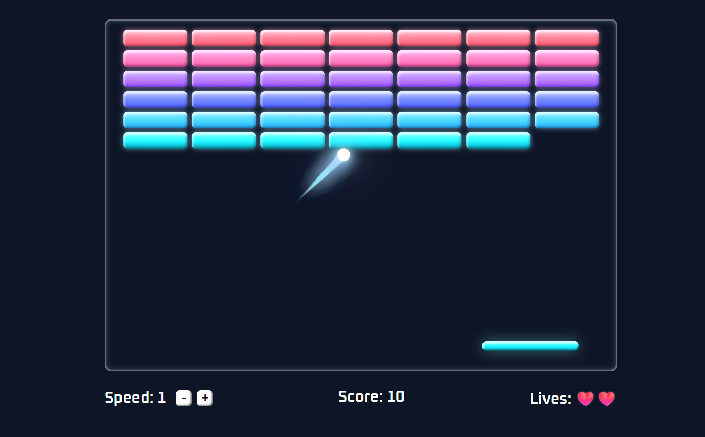

# 🧱 Breakout

A classic brick-breaker game built with **React + TypeScript**: smooth `requestAnimationFrame` game loop, canvas particle effects and a responsive board.

🎮 **[Play the live demo](https://alena0490.github.io/BrickBreaker/)**



---

## ✨ Features

- 🏓 **Paddle control:** mouse or arrow keys
- ⚡ **Adjustable speed:** a higher speed gives a higher score per brick
- ❤️ **Lives system:** 3 lives, the ball resets to the paddle after each miss
- 🎯 **Angle-based bounces:** where the ball hits the paddle sets its rebound angle
- 🌠 **Glowing ball trail** rendered on a `<canvas>` overlay
- 💥 **Brick debris** with gravity and fade-out
- 📐 **Responsive:** positions, speeds and the canvas rescale on window resize
- ⏸️ **Pause / resume** at any time

## 🕹️ Controls

| Action | Input |
| --- | --- |
| Start | `Space` or mouse click |
| Pause / resume | `Space` |
| Move paddle | Mouse or `←` / `→` |
| Restart | **Play Again** button after win / game over |

## 🛠️ Tech Stack

- [React](https://react.dev/)
- [TypeScript](https://www.typescriptlang.org/)
- [Vite](https://vitejs.dev/)
- Canvas 2D API (particle effects)

## 🚀 Getting Started

```bash
# clone the repository
git clone https://github.com/Alena0490/BrickBreaker.git
cd BrickBreaker

# install dependencies
npm install

# start the dev server
npm run dev

# production build
npm run build
```

## 📁 Project Structure

``` src/
├── components/
│   ├── Gameboard.tsx   # game loop, input, physics, particle rendering
│   ├── Stats.tsx
│   ├── Paddle.tsx
│   ├── Ball.tsx
│   └── Brick.tsx
├── data/
│   └── brickData.ts    # initial brick layout
├── utils/
│   └── collision.ts    # brick rect cache + ball/brick collision
└── App.css
```

## ⚙️ How It Works

- **Game loop outside React:** positions, velocities and game status live in local variables and refs inside a single `useEffect`, so moving objects never trigger a re-render. React state changes only when a brick breaks, a life is lost or the status changes.
- **Direct DOM transforms:** the paddle and ball move via `style.transform`, which the browser can composite without recalculating layout.
- **Frame-rate independence:** each frame's movement is scaled by `dt` (normalized to 60 FPS and capped), so the game runs at the same speed on 60 Hz and 144 Hz displays.
- **Cached brick geometry:** brick rectangles are measured once and rebuilt only on resize, which avoids calling `getBoundingClientRect()` every frame.
- **Allocation-free particles:** trail and debris arrays are compacted in place instead of being recreated with `.filter()` each frame.

## 🎨 Tweaking Effects

All visual effects are configured in the `FX` object in `Gameboard.tsx`:

```ts
FX.trail.fade      // trail length (higher = shorter)
FX.trail.glow      // glow intensity
FX.debris.count    // debris pieces per brick
FX.debris.gravity  // how fast debris falls
```

## 📄 License

MIT
